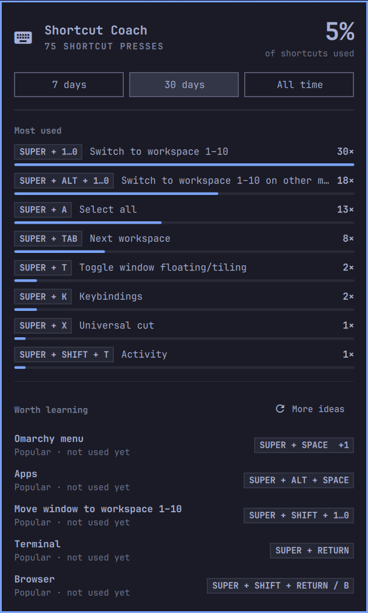

# Shortcut Coach

Bar widget that counts which Hyprland shortcuts you actually use and suggests
popular ones that aren't a habit yet (fewer than 3 uses in the chosen range).



## Install

```bash
omarchy plugin add https://github.com/tyku8/omarchy-shortcut-coach
~/.config/omarchy/plugins/tyku8.shortcut-coach/setup
```

`omarchy plugin add` installs the bar widget (it suggests the spot beside the
clock). `setup` adds one line to `~/.config/hypr/hyprland.lua`, before Omarchy's
defaults load, so the tracker can see every bind. It backs up `hyprland.lua`
first and reloads Hyprland. Until it runs, the panel says tracking isn't active.

**Privacy:** only Hyprland *shortcuts* are logged (time, keys, description),
never ordinary typing, and only to a local file. Nothing leaves your machine.

## How it works

- `hypr/tracker.lua` is loaded from `~/.config/hypr/hyprland.lua` *before*
  Omarchy's defaults. It wraps `hl.bind`/`hl.unbind`:
  - on every config load it writes the live bind table to `catalog.tsv`;
  - each time a bound shortcut fires it appends `epoch<TAB>keys<TAB>description`
    to `presses.tsv`. Ordinary typing is never seen, only bound shortcuts.
  - Held repeating binds (volume, resize) count once per hold. Mouse, release
    and pass-through binds are not tracked.
- Data lives in `~/.local/state/omarchy/shortcut-coach/`. `presses.tsv` rotates
  to `presses.tsv.1` past 2 MB. Delete the folder to reset your stats.
- `Model.js` groups binds into families (workspace 1–10, focus left/right/…),
  counts usage and ranks recommendations with the `POPULAR` weights.

## Panel

Click the keyboard icon next to the clock. ←/→ switch range (7 days / 30 days /
all time), Enter or "More ideas" shows the next page of suggestions.

## Uninstall

```bash
~/.config/omarchy/plugins/tyku8.shortcut-coach/setup --remove   # stop tracking
omarchy plugin remove tyku8.shortcut-coach                       # remove the widget
rm -r ~/.local/state/omarchy/shortcut-coach                      # delete your stats
```

Run `setup --remove` before `plugin remove`; the tracker line fails silently
(it is wrapped in `pcall`) if the plugin folder is gone, but it is cleaner gone.

## Requirements

Omarchy with the Lua Hyprland config (`~/.config/hypr/hyprland.lua`, Hyprland
0.55+). Edits to `Model.js` or `Panel.qml` may need `omarchy restart shell`.

## Tests

    node tests/model.test.js
